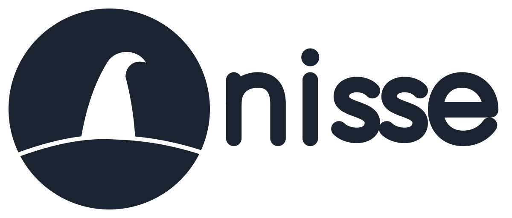

<p align="center"></p>

# Nisse

A custom Linux distribution, assembled step by step.

Named for the nisse (Danish/Norwegian; Swedish *tomte*), the small bearded household
spirit of Scandinavian folklore that quietly looks after the farm and the family.

## Status

Day zero. No build system, base, or package set chosen yet.

## Branches

- `main` - stable. Only known-good state lands here.
- `daily` - day-to-day integration. Work lands here first and is promoted to `main`
  once it builds and boots.

## License

GPL-2.0-or-later. See [LICENSE](LICENSE).

Source files should carry an SPDX header where the format allows it:

```
SPDX-License-Identifier: GPL-2.0-or-later
```
