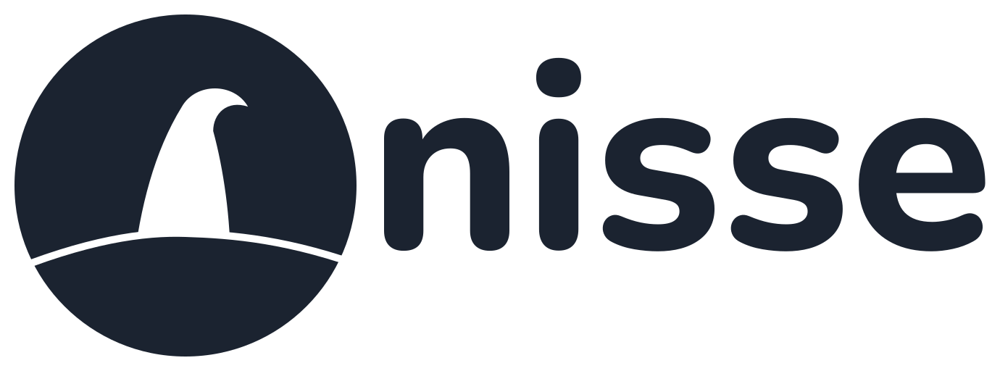

<p align="center"></p>

# nisse

A custom Linux distribution, assembled step by step.

Named for the nisse (Danish/Norwegian; Swedish *tomte*), the small bearded household
spirit of Scandinavian folklore that quietly looks after the farm and the family.

## Status

Pre-release (product version 0.2). A branded Fedora 44 KDE live ISO built with kiwi boots to Plasma, with a Rust daemon
and a QML panel that talk to the Claude CLI. Nothing has run on real hardware yet. The plan and task queue are in
`docs/roadmap.md` and `docs/planning/TASK-LEDGER.md`.

## Branches

- `main` - stable. Only known-good state lands here.
- `daily` - day-to-day integration. Work lands here first and is promoted to `main`
  once it builds and boots.

## License

GPL-2.0-or-later. See [LICENSE](LICENSE).

Third-party assets keep their own licenses. The bundled Nunito font (`assets/fonts/Nunito/`) is
SIL OFL 1.1. The vendored Fedora kiwi description (`build/kiwi/fedora/`) is GPL-3.0 (see its `COPYING`).

Source files should carry an SPDX header where the format allows it:

```
SPDX-License-Identifier: GPL-2.0-or-later
```
